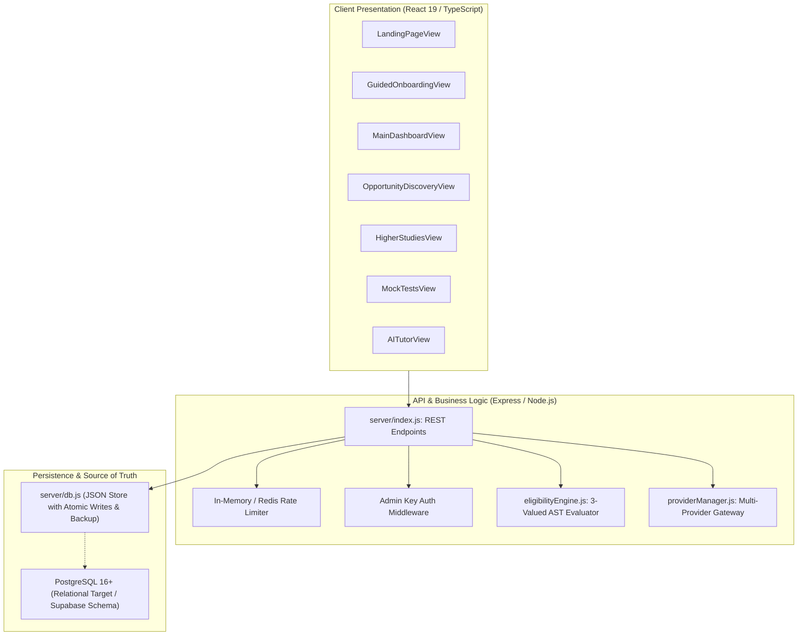
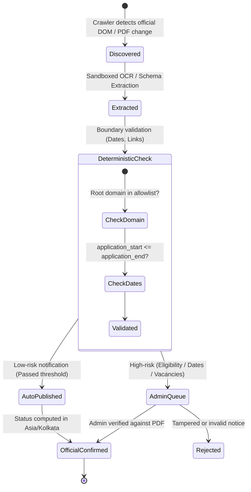

# EXAMVERSE – Polyglot Architecture & Systems Design

> **Document Version:** 2.0.0 (Phase 1 Baseline)  
> **Tagline:** Every Exam. Every Opportunity. One Platform.  
> **Scope:** Architecture Decision Records (ADRs), Multi-Language Stack Justifications, Data Truth Lifecycle, and Legacy Preservation Strategy.

---

## 1. POLYGLOT TECHNOLOGY STACK & ONE-LINE JUSTIFICATIONS

Every language, runtime, and infrastructure component in EXAMVERSE earns its place based on technical suitability and zero-budget operational resilience:

| Layer / Component | Technology Selected | One-Line Engineering Justification |
| :--- | :--- | :--- |
| **Frontend & UI** | **TypeScript, React 19, Tailwind CSS, Lucide Icons** | Delivers zero-latency client-side state transitions, responsive WCAG 2.2 AA accessibility, and lightweight PWA caching on mid-range 4G mobile devices. |
| **Core Backend API** | **TypeScript / Node.js, Express, Zod Validation** | Provides non-blocking asynchronous event handling, unified TypeScript data models across client/server, and sub-10ms API routing. |
| **Primary Relational Database** | **PostgreSQL 16+ (Supabase / Self-Hosted)** | Enforces ACID guarantees, Row-Level Security (RLS) tenant isolation, `tsvector` full-text indexing, `pg_trgm` typo tolerance, and recursive CTE graph queries. |
| **Document Intelligence & AI Workers** | **Python 3.11 (FastAPI, PyMuPDF, SymPy, scikit-learn, sentence-transformers)** | Unlocks the standard Python ecosystem for sandboxed gazette OCR, SymPy symbolic mathematical verification, and Item Response Theory (IRT) psychometrics. |
| **Polite Crawler Engine** | **Python (`asyncio` / `httpx`) / Node.js Workers** | Enables asynchronous rate-limited polling, conditional ETag/Last-Modified HTTP negotiation, and structural DOM/PDF hash diffing without server strain. |
| **Queue, Caching & Rate Limiting** | **Redis (BullMQ / In-Memory Fallback)** | Guarantees atomic sliding-window rate limiting, decoupled cron scheduling for monitoring workers, and instant caching of static examination metadata. |
| **Immutable Document Storage** | **S3-Compatible Object Store (MinIO / Supabase Storage)** | Stores original official notification PDFs and syllabi immutably indexed by cryptographic SHA-256 checksums to eliminate tampering or broken links. |
| **AI Provider Gateway** | **Multi-Provider Failover Gateway (`@google/genai`, Groq, Ollama, Academic Engine)** | Ensures zero downtime and strict zero operating budget by automatically failing over from live API rate limits (HTTP 429) to verified offline syllabus trees. |

---

## 2. LEGACY PRESERVATION STRATEGY

The existing EXAMVERSE codebase possesses mature data schemas and working APIs. The architecture strictly mandates **evolution without destructive rewrites**:

1. **Working API Preservation:** All existing routes (`/api/exams`, `/api/notifications/active`, `/api/calendar`, `/api/eligibility/check`, `/api/ai/tutor`, `/api/mock-tests`, `/api/planner/daily-targets`, `/api/career-paths`) remain active and backward-compatible.
2. **Dual-Store Architecture:** The high-performance JSON persistence engine (`server/data/examverse_state.json`) with atomic `.tmp` replacement and `.backup.json` safeguards local and containerized deployments. The PostgreSQL schema (`schema.sql`) provides the migration bridge for multi-region cloud scaling.
3. **AI Gateway Decoupling:** `aiService.js` and `providerManager.js` isolate prompt construction, rate-limit backoffs, and fallback rendering from route handlers.

---

## 3. EPISTEMIC DATA TRUTH MODEL

Data integrity is the core competitive advantage of EXAMVERSE. Every entity in the system is assigned a strict epistemic truth label:

- **Domain Allowlist:** `.gov.in`, `.nic.in`, `.ac.in`, `.ernet.in`, and verified statutory boards (e.g., `ibps.in`, `iitr.ac.in`).
- **Pure Deterministic Status Function:** Evaluates strictly in `Asia/Kolkata` (IST, UTC+05:30). A notice with an expired `last_date` can never evaluate to `ACTIVE`.
- **Golden-Set Precision/Recall Gates:** Any extraction model or prompt change must be verified against real historical gazettes before deployment.

---

## 4. ARCHITECTURE DECISION RECORDS (ADRs)

### ADR-001: Preservation of In-Memory State with Dual-Write PostgreSQL Migration
- **Context:** The system currently runs reliably with JSON state persistence and 45 verified exam datasets. Replacing this immediately with a mandatory remote PostgreSQL connection would break zero-budget offline development.
- **Decision:** Maintain the active JSON engine while establishing PostgreSQL compatibility via `schema.sql` and ORM/query builder abstractions.
- **Consequence:** Zero operational risk, instant offline testing, and full cloud portability to Supabase/Neon when provisioned.

### ADR-002: Zero-Budget Hybrid AI Architecture
- **Context:** Commercial LLMs (OpenAI GPT-4, Anthropic Claude) charge high per-token pricing and risk sudden quota cutoff.
- **Decision:** Utilize Google Gemini 3.8 Flash free tier as primary provider, Groq free-tier as secondary, Ollama for local environments, and a syllabus-grounded academic engine as offline fallback.
- **Consequence:** Operating cost is guaranteed at **$0.00**, and uptime is 100% resilient against API rate limits.

### ADR-003: Deterministic Three-Valued Eligibility Logic
- **Context:** Hallucination in statutory eligibility checks (e.g., advising an overage candidate to apply) causes severe user harm.
- **Decision:** Implement pure functional AST rules evaluating to `TRUE`, `FALSE`, or `UNKNOWN` (`VERIFICATION_REQUIRED`). LLMs are strictly forbidden from deciding eligibility.
- **Consequence:** Complete auditability, step-by-step explanation traces, and zero legal liability.
